# Evidências dos testes manuais

Todos os cenários foram validados manualmente no ambiente Docker do projeto, com os dados do seed (`composer run phinx:seed`). Os prints estão em `docs/evidences/`.

## Resumo

| # | Cenário | Resultado |
|---|---|---|
| 1.1 | Cadastrar pessoa e ver na listagem | OK |
| 1.2 | Cadastrar com CPF já existente | OK |
| 1.3 | Editar pessoa | OK |
| 1.4 | Excluir pessoa | OK |
| 1.5 | Enviar formulário vazio | OK |
| 1.6 | CPF incompleto e e-mail inválido | OK |
| 1.7 | Data de nascimento futura | OK |
| 1.8 | Reutilizar CPF de pessoa excluída | Falha no back-end (tratada no front) |
| 1.9 | Data digitada sem barras | OK após correção no front |
| 2.1 | Consultar envolvidos de um relato | OK |
| 2.2 | Vincular pessoa a um relato | OK |
| 2.3 | Relato sem relatante aparece como anônimo | OK |
| 2.4 | Relato volta a identificado ao vincular relatante | OK |
| 2.5 | Vincular sem preencher os campos | OK |
| 2.6 | Envolvidos de outro relato | OK |
| 2.7 | Vincular de novo uma pessoa removida | Falha no back-end (tratada no front) |
| 2.8 | Excluir pessoa vinculada a um relato | OK após correção no front |
| E.1 | Busca por nome ou CPF | OK |
| E.2 | Indicadores e gráfico no Dashboard | OK |
| E.3 | Interface em português | OK |
| E.4 | Painel de envolvidos em tela pequena | OK |

Os problemas encontrados estão detalhados na seção [Problemas encontrados](#problemas-encontrados).

---

## Épico 1 — Pessoa

### 1.1 Cadastrar pessoa e ver na listagem

*Cenário sugerido no PRD.*

**Passos**
1. Acessar **Pessoas** no menu lateral.
2. Clicar em **Cadastrar**.
3. Preencher nome, CPF com 11 dígitos, e-mail e data de nascimento.
4. Clicar em **Cadastrar**.

**Esperado:** o modal fecha e a pessoa aparece na tabela, com o CPF formatado (`000.000.000-00`) e a data em `DD/MM/AAAA`.

**Obtido:** conforme esperado.

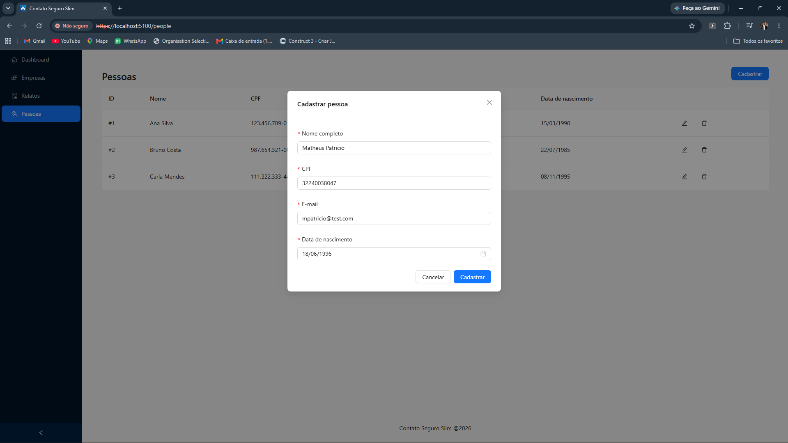

### 1.2 Cadastrar com CPF já existente

*Cenário sugerido no PRD.*

**Passos**
1. Abrir o modal de cadastro.
2. Preencher os campos usando o CPF de uma pessoa ativa.
3. Clicar em **Cadastrar**.

**Esperado:** o cadastro é recusado e o usuário entende o motivo.

**Obtido:** a API responde 409 e a mensagem "Já existe uma pessoa cadastrada com este CPF." aparece embaixo do campo CPF. O modal continua aberto e nenhuma pessoa é criada.

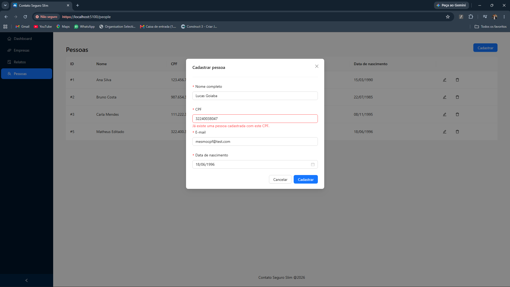

### 1.3 Editar pessoa

**Passos**
1. Clicar no ícone de editar de uma pessoa.
2. Conferir os dados preenchidos.
3. Alterar o nome e o e-mail e clicar em **Confirmar**.

**Esperado:** o modal abre com os dados atuais, inclusive a data no calendário, e a tabela reflete as alterações.

**Obtido:** conforme esperado.

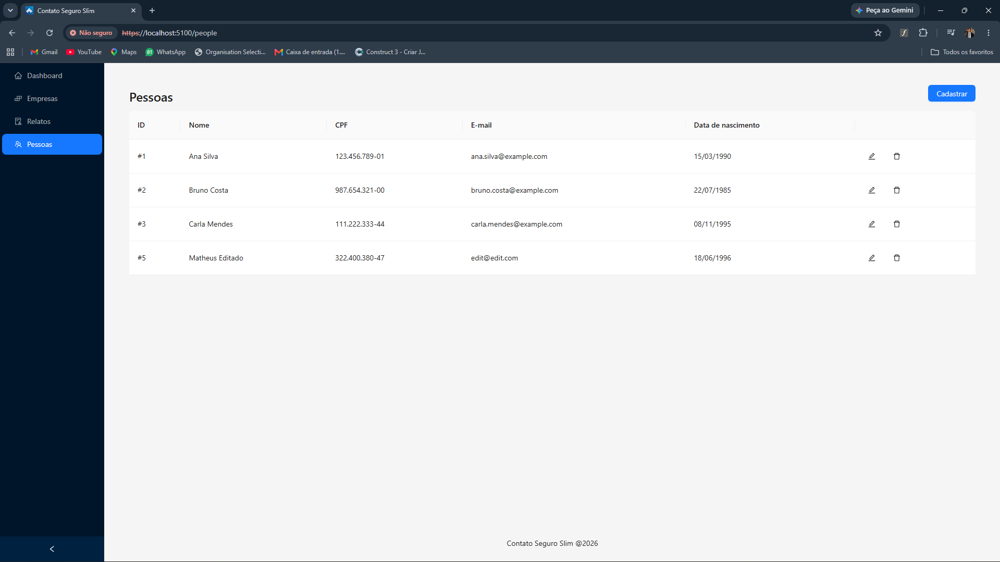

### 1.4 Excluir pessoa

**Passos**
1. Clicar no ícone de excluir.
2. Confirmar em **Sim**.

**Esperado:** a exclusão pede confirmação e a pessoa sai da listagem.

**Obtido:** conforme esperado.

### 1.5 Enviar formulário vazio

**Passos**
1. Abrir o modal de cadastro.
2. Clicar em **Cadastrar** sem preencher nada.

**Esperado:** mensagem de campo obrigatório nos quatro campos, sem chamada à API.

**Obtido:** conforme esperado. A validação acontece no navegador; nenhuma requisição aparece na aba Network.

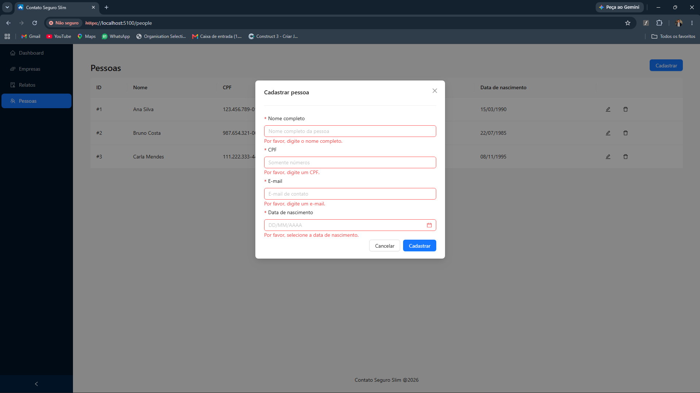

### 1.6 CPF incompleto e e-mail inválido

**Passos**
1. Abrir o modal de cadastro.
2. Digitar `12345` no CPF e `teste@` no e-mail.
3. Clicar em **Cadastrar**.

**Esperado:** "O CPF deve ter 11 dígitos." e "Por favor, digite um e-mail válido."

**Obtido:** conforme esperado.

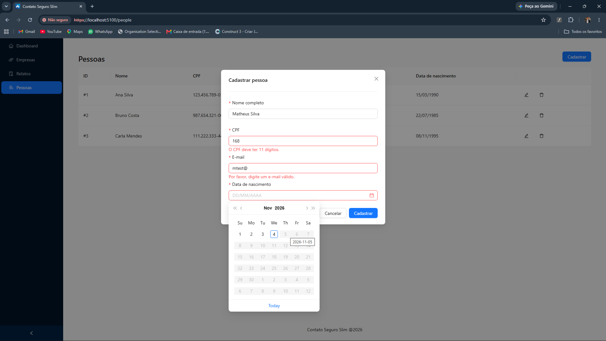

### 1.7 Data de nascimento futura

**Passos**
1. Abrir o calendário da data de nascimento.
2. Tentar selecionar uma data depois de hoje.

**Esperado:** datas futuras indisponíveis.

**Obtido:** os dias depois de hoje aparecem desabilitados e não podem ser selecionados.

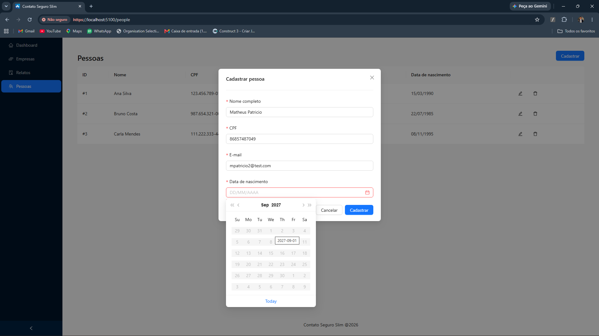

### 1.8 Reutilizar CPF de pessoa excluída

*Cenário de falha.*

**Passos**
1. Cadastrar uma pessoa e excluí-la.
2. Cadastrar outra pessoa com o mesmo CPF.

**Esperado:** o cadastro funciona, já que a pessoa anterior foi excluída, ou é recusado com uma mensagem clara.

**Obtido:** a API responde 500 por violação do índice único de CPF. Antes da correção, a mensagem crua do SQL aparecia na tela. Depois, o front exibe "Não foi possível concluir a operação por um erro no servidor." Detalhes em [Problemas encontrados](#back-end-soft-delete-com-índice-único).

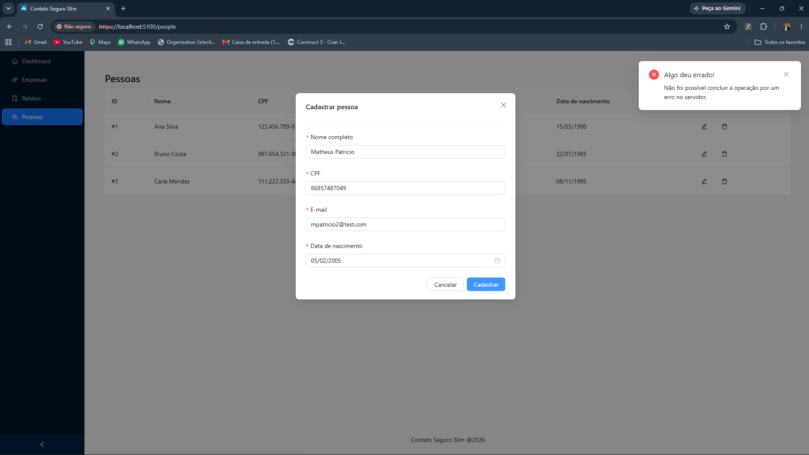

### 1.9 Data digitada sem barras

**Passos**
1. Abrir o modal de cadastro.
2. Digitar `15031990` no campo de data.

**Esperado:** a data é reconhecida como 15/03/1990.

**Obtido:** na primeira rodada de testes, a data só era aceita com as barras. Corrigido no commit `fix: accept birth date typed without separators`: o campo passou a aceitar os dois formatos e exibe a data com barras assim que os oito dígitos são digitados.

Observação: o campo aceita digitar mais caracteres do que o formato prevê, mas um valor inválido é descartado ao sair do campo, e a data anterior é mantida. Nada inválido chega ao formulário.

---

## Épico 2 — Envolvimento

### 2.1 Consultar envolvidos de um relato

**Passos**
1. Acessar **Relatos**.
2. Clicar no ícone **Envolvidos** do relato #1.

**Esperado:** um painel lateral mostra os envolvidos do relato (nome, CPF e tipo) e indica se o relato é anônimo ou identificado.

**Obtido:** conforme esperado. O relato #1 aparece como **Identificado**, com Ana Silva (Relatante) e Bruno Costa (Denunciado).

### 2.2 Vincular pessoa a um relato

*Cenário sugerido no PRD.*

**Passos**
1. No painel do relato #1, selecionar Carla Mendes e o tipo **Testemunha**.
2. Clicar em **Vincular**.
3. Abrir a seleção de pessoa de novo.

**Esperado:** a pessoa entra na lista de envolvidos e deixa de aparecer na seleção.

**Obtido:** conforme esperado. Com as três pessoas do seed vinculadas, a seleção fica vazia, o que evita a duplicata antes de chegar à API.

### 2.3 Relato sem relatante aparece como anônimo

*Cenário sugerido no PRD.*

**Passos**
1. No relato #1, remover Ana Silva, a única relatante.
2. Confirmar em **Sim**.

**Esperado:** o indicador muda para **Anônimo** sem nenhuma ação extra.

**Obtido:** conforme esperado. O indicador vem do `is_anonymous` da API, buscado de novo após a remoção.

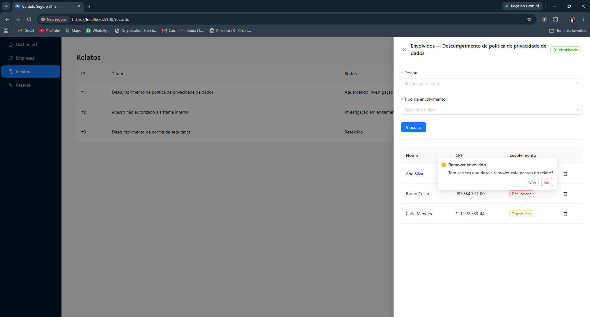

### 2.4 Relato volta a identificado ao vincular relatante

**Passos**
1. Cadastrar uma pessoa nova (Daniel Souza).
2. No relato #1, vinculá-la como **Relatante**.

**Esperado:** o indicador volta para **Identificado**.

**Obtido:** conforme esperado. A seleção mostra apenas quem ainda não está no relato.

### 2.5 Vincular sem preencher os campos

*Cenário de falha sugerido no PRD.*

**Passos**
1. No painel de um relato, clicar em **Vincular** sem preencher nada.

**Esperado:** mensagens de campo obrigatório, sem chamada à API.

**Obtido:** "Por favor, selecione uma pessoa." e "Por favor, selecione o tipo de envolvimento."

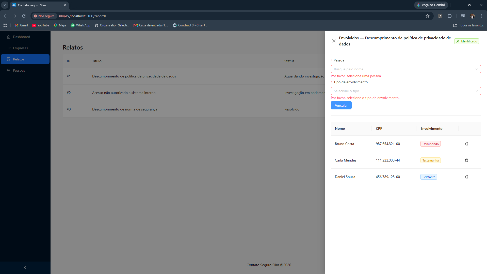

### 2.6 Envolvidos de outro relato

**Passos**
1. Fechar o painel e abrir o do relato #2.

**Esperado:** apenas os envolvidos do relato #2.

**Obtido:** conforme esperado. O relato #2 tem só uma testemunha e aparece como **Anônimo**: o anonimato depende da ausência de relatante, não da ausência de envolvidos.

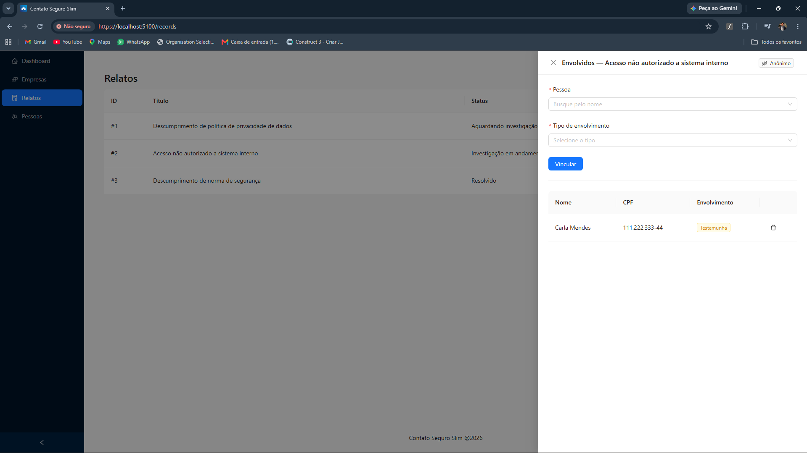

### 2.7 Vincular de novo uma pessoa removida

*Cenário de falha.*

**Passos**
1. Remover uma pessoa de um relato.
2. Tentar vinculá-la de novo ao mesmo relato.

**Esperado:** o vínculo é refeito, ou recusado com 409, como o `API.md` descreve para duplicatas.

**Obtido:** a API responde 500 por violação do índice único (relato, pessoa). O front mostra a mensagem amigável no lugar do SQL. Detalhes em [Problemas encontrados](#back-end-soft-delete-com-índice-único).

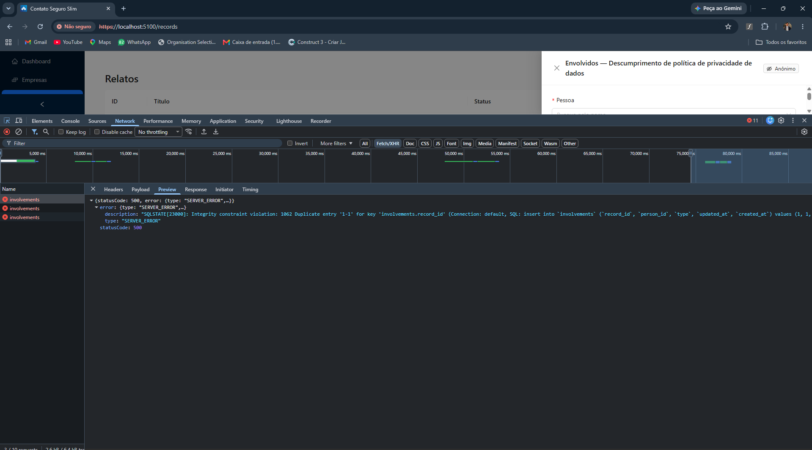

### 2.8 Excluir pessoa vinculada a um relato

**Passos**
1. Cadastrar uma pessoa e vinculá-la como **Relatante** no relato #3.
2. Excluir essa pessoa em **Pessoas**.
3. Abrir o painel do relato #3.

**Esperado:** o painel continua funcionando e deixa claro que a pessoa foi excluída.

**Obtido:** na primeira rodada, a aplicação quebrava: a API devolve o envolvimento com `person: null`, e a tabela tentava formatar o CPF de uma pessoa inexistente. Corrigido no commit `fix: handle involvements whose person was deleted`. Agora a linha mostra "Pessoa excluída", e o envolvimento ainda pode ser removido.

Observação: o relato continua **Identificado**. O back-end mantém o envolvimento de relatante mesmo com o cadastro da pessoa excluído.

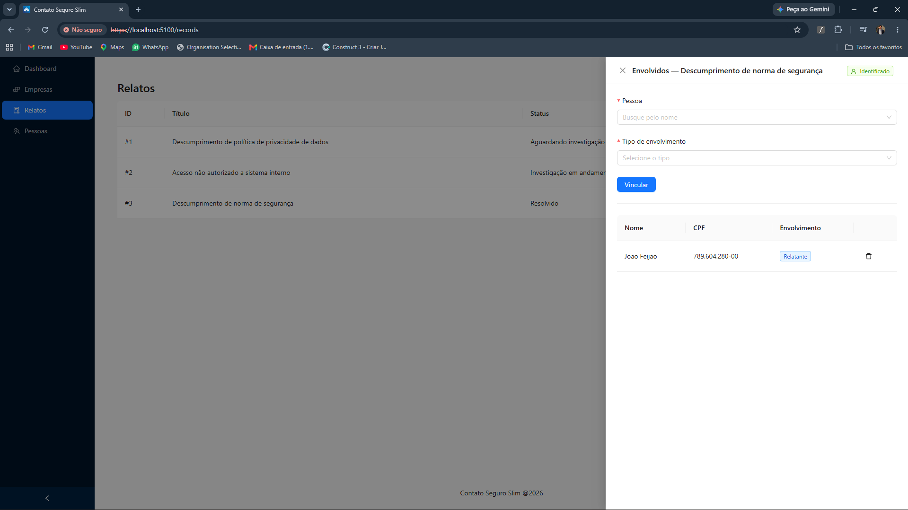
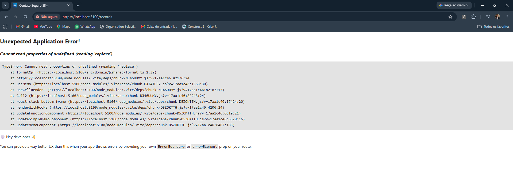

---

## Extras

### E.1 Busca por nome ou CPF

**Passos**
1. Em **Pessoas**, digitar "ana", depois "ANA", depois "123.456" e depois "123456" no campo de busca.
2. Limpar o campo.

**Esperado:** as quatro buscas encontram Ana Silva, e ao limpar a lista completa volta.

**Obtido:** conforme esperado. A busca ignora acentos e maiúsculas no nome e compara o CPF só pelos dígitos.

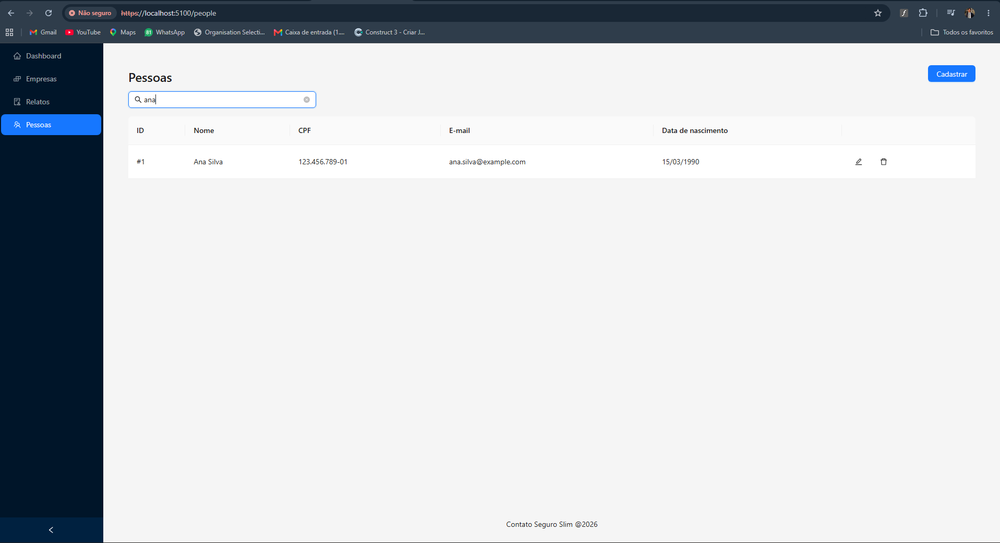

### E.2 Indicadores e gráfico no Dashboard

**Passos**
1. Acessar o **Dashboard**.
2. Comparar os números com as listas de Empresas, Relatos e Pessoas.

**Esperado:** os indicadores batem com as listas, e o gráfico mostra a distribuição dos relatos por status.

**Obtido:** conforme esperado. Cada status tem sua cor e a porcentagem em relação ao total de relatos.

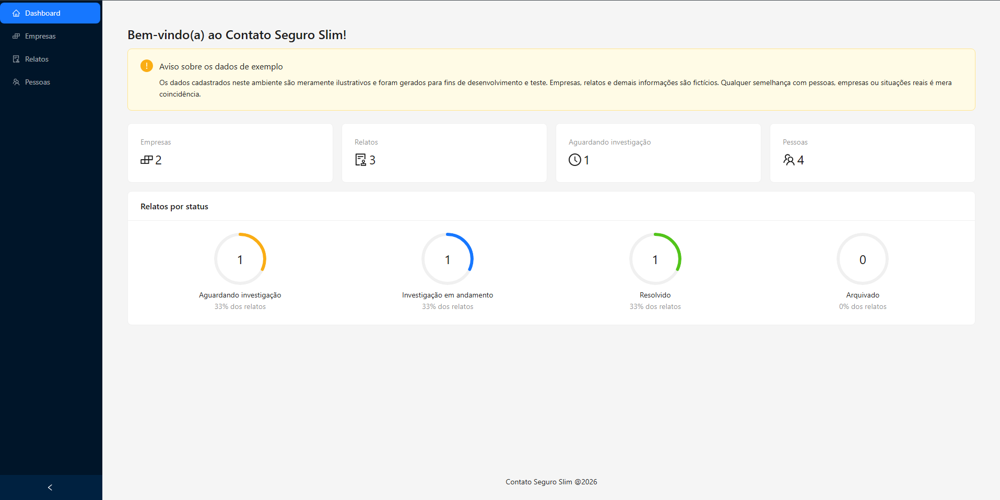

### E.3 Interface em português

**Passos**
1. Abrir o calendário da data de nascimento.
2. Em **Pessoas**, buscar um termo sem resultados.

**Esperado:** os textos dos componentes em português.

**Obtido:** antes da configuração, os componentes do Ant Design exibiam textos em inglês, como os dias da semana, o botão "Today" e o "No data" da tabela vazia. Com o idioma configurado no `App.tsx`, aparecem em português.

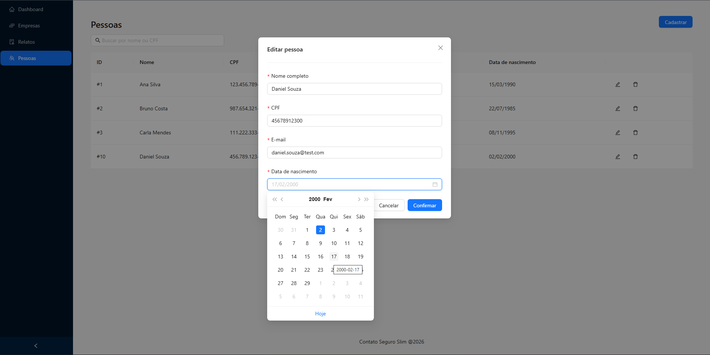

### E.4 Painel de envolvidos em tela pequena

**Passos**
1. No DevTools, simular uma tela de 436 px de largura.
2. Abrir o painel de envolvidos de um relato.

**Esperado:** o painel cabe na tela e continua funcional.

**Obtido:** conforme esperado. O painel se ajusta à largura disponível; o CPF quebra em duas linhas por falta de espaço, sem prejudicar o uso.

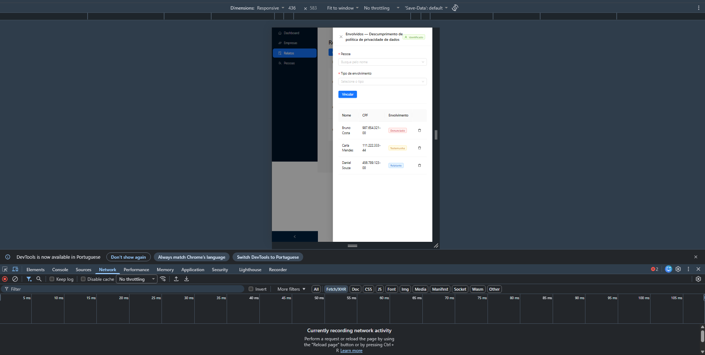

---

## Problemas encontrados

### Back-end: soft delete com índice único

Aparece em dois lugares, com a mesma causa:

- **Pessoas (1.8):** o CPF de uma pessoa excluída não pode ser usado de novo.
- **Envolvimentos (2.7):** uma pessoa removida de um relato não pode ser vinculada a ele de novo.

**Causa:** ao excluir, a API faz soft delete (preenche `deleted_at`). A checagem de duplicidade do back ignora os registros excluídos e deixa a operação seguir, mas o índice único do banco continua valendo para eles. O insert falha com `SQLSTATE[23000]: Integrity constraint violation: 1062 Duplicate entry` e a API responde 500.

**Impacto:** sem rota de edição de envolvimento, o caminho natural para trocar o tipo seria remover e vincular de novo, e isso não funciona.

**O que foi feito no front:** como o back-end não pode ser alterado, os erros 5xx passaram a exibir uma mensagem amigável em vez do SQL (`fix: hide internal server error details from users`). A limitação também foi registrada no design plan.

**Correção sugerida no back-end:** restaurar o registro excluído em vez de criar outro, ou considerar `deleted_at` na regra de unicidade.

### Front-end: tabela de envolvidos com pessoa excluída

Descrito em 2.8. Corrigido em `fix: handle involvements whose person was deleted`.

### Front-end: data digitada sem barras

Descrito em 1.9. Corrigido em `fix: accept birth date typed without separators`.

---

## Outras verificações

**Back-end não alterado.** Nenhum arquivo de `server/` mudou desde o commit inicial:

    git diff --stat 76eec3c HEAD -- server

O comando não retorna nada.

**Lint.** `pnpm lint` roda sem problemas. Na primeira execução, apontou a ordem dos imports (regra `simple-import-sort` do projeto) e a indentação de um arquivo alterado; ambos foram corrigidos em `style: fix import order and indentation reported by lint`.

**Tipagem.** `tsc -p tsconfig.app.json --noEmit` roda sem erros. A checagem acusava 4 erros de tipo pré-existentes no mock de `service.helper.test.ts`, corrigidos em `test: fix antd app mock typing in service helper tests`.

**Testes unitários.** `pnpm test` passa com 20 testes: os 7 que já existiam e 13 novos, que cobrem a formatação de CPF e data, a identificação de conflito (409), a mensagem amigável para erros 5xx e a conversão entre o formulário de pessoa e a API.

**Build de produção.** `pnpm build` gera o build sem erros. O Vite avisa que o pacote final passa de 500 kB, principalmente pelo Ant Design; a sugestão de code splitting está nas melhorias futuras do design plan.